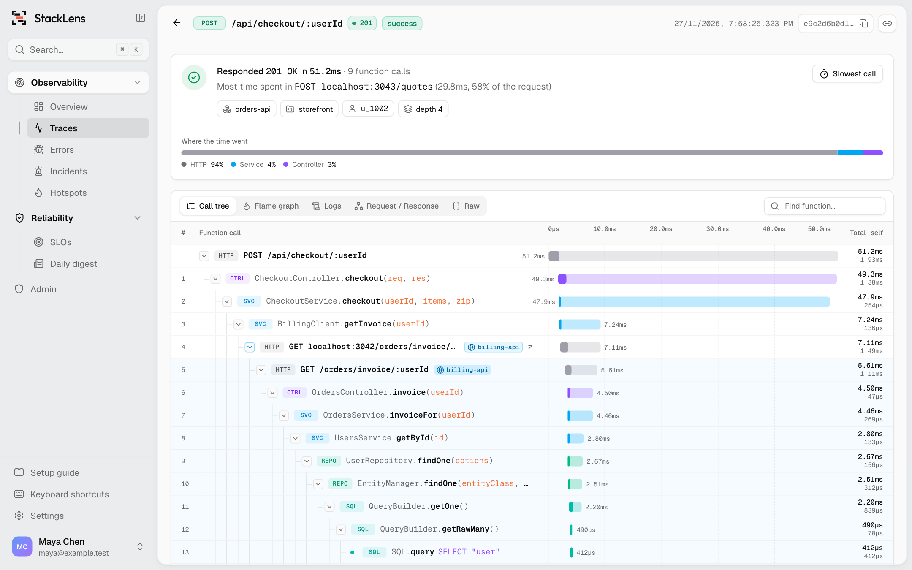
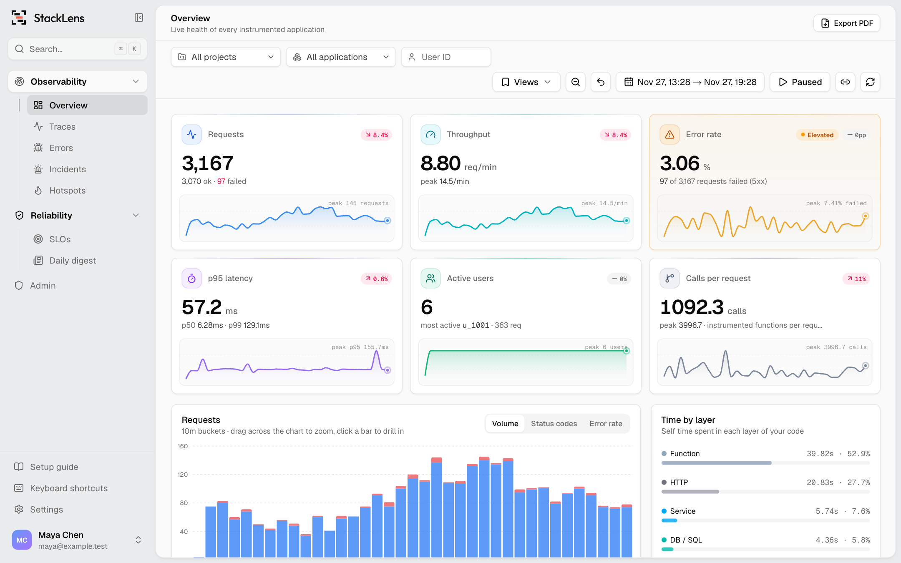
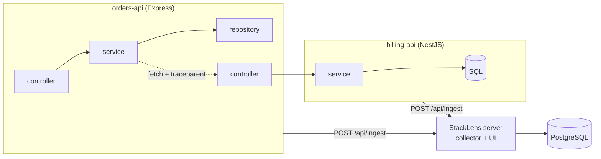
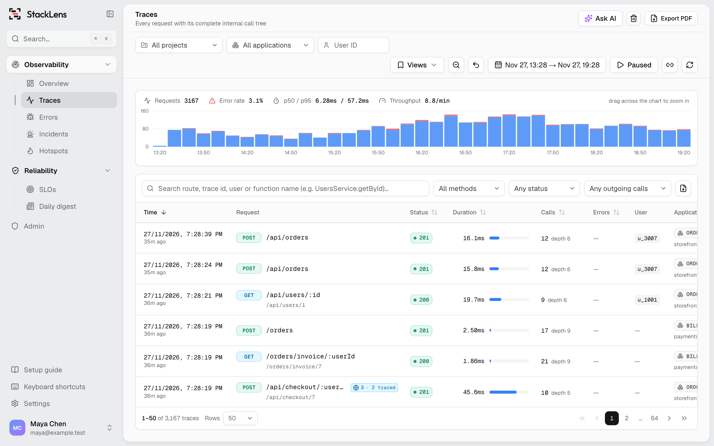

<div align="center">

<picture>
  <source media="(prefers-color-scheme: dark)" srcset="docs/images/logo-dark.svg">
  
</picture>

# StackLens

**See every function call inside every request.**<br>
Call-tree tracing for Node.js and Python backends: arguments, return values, SQL, errors and logs, function by function, across services.

[](https://github.com/anjanirathamsetti/stacklens/actions/workflows/ci.yml)
[](LICENSE)


[Quick start](#quick-start) · [Features](#features) · [How it works](#how-it-works) · [Cross-service tracing](#cross-service-tracing) · [Docs](#documentation)

<br>

<picture>
  <source media="(prefers-color-scheme: dark)" srcset="docs/images/trace-detail-dark.png">
  
</picture>

</div>

## Why StackLens

APM tools tell you a request was slow. Logs tell you what someone remembered to print. StackLens records **what your code actually did**: every controller, service, repository and SQL call in a request, with the values that went in and came out, so you can debug production behaviour without adding a single `console.log`.

- 🔍 **Function-level detail.** Each call keeps its arguments, return value, inferred TypeScript type, thrown error and log lines.
- 🧩 **Drop-in.** One `init()` plus a middleware. NestJS, Express and TypeORM are instrumented automatically.
- 🌐 **Across services.** Outgoing `fetch`/axios/`http` calls carry W3C `traceparent`, so a downstream API's call tree shows up inline under the call that made it.
- 🛡️ **Safe by default.** Secrets are redacted, capture is bounded per trace, and loops are collapsed, so a 10,000-item loop doesn't blow up memory.
- 🏠 **Self-hosted.** One process and PostgreSQL (or an embedded database for local use). Your data stays on your servers.

## Features

<table>
<tr>
<td width="50%" valign="top">

**🌳 Call trees**<br>
Waterfall and flame graph for every request, with an inspector for each call's input, output, errors and logs. SQL and signatures are formatted and highlighted, and big JSON values are searchable.

</td>
<td width="50%" valign="top">

**🌐 Cross-service tracing**<br>
Expand a downstream API's call tree right under the outgoing call. Services without StackLens still show the full request and response, with a clear "call graph not available" note.

</td>
</tr>
<tr>
<td valign="top">

**📈 Overview and hotspots**<br>
Live KPIs, request, latency, status-code and error-rate charts (drag to zoom), time by layer, top endpoints and users, plus every function ranked by calls, latency and self time.

</td>
<td valign="top">

**🚨 Errors and incidents**<br>
Exceptions grouped by where they were thrown, client and server errors told apart, regressions flagged, and ServiceNow incidents linked to error groups (a local mode works without an instance).

</td>
</tr>
<tr>
<td valign="top">

**🎯 SLOs and daily digest**<br>
Per-route latency and availability objectives with error budgets, and a daily summary that can post to Slack.

</td>
<td valign="top">

**📄 PDF reports**<br>
Export Overview, Traces, Errors, Hotspots, SLOs, the digest and admin tables as clean A4 reports with the filters you applied.

</td>
</tr>
<tr>
<td valign="top">

**🔐 Accounts and admin**<br>
Admin, member and viewer roles, ingest API keys, session and password policy, team settings and an audit log.

</td>
<td valign="top">

**🧭 Filters that travel**<br>
Project, application, environment, user and a CloudWatch-style time picker. All filter state lives in the URL, and saved views keep it handy.

</td>
</tr>
</table>

<picture>
  <source media="(prefers-color-scheme: dark)" srcset="docs/images/overview-dark.png">
  
</picture>

## Quick start

> [!NOTE]
> StackLens isn't published to npm or PyPI yet. Run the server from source or as a Docker image you build locally, and install the SDKs from the repo.

**1. Run the server**

```bash
git clone https://github.com/anjanirathamsetti/stacklens.git
cd stacklens
npm install
npm run dev                      # http://localhost:4300 (embedded database, hot reload)
```

Or with Docker (PostgreSQL included):

```bash
npm run docker:up                # docker compose -f deploy/docker-compose.yml up --build
```

Open http://localhost:4300 and create the admin account. Add teammates later in **Admin → Users**.

**2. Instrument your API**

Until the SDKs are published, install them from the repo. Node.js:

```bash
npm run build:packages                                  # in the stacklens repo
npm install /path/to/stacklens/sdks/node-tracer         # in your API
```

<details open>
<summary><b>NestJS + TypeORM</b></summary>

```ts
// main.ts
import { stacklens } from '@stacklens/node-tracer';
import * as typeorm from 'typeorm';

stacklens.init({ application: 'billing-api', project: 'payments' });
stacklens.instrumentTypeORM(typeorm);

const app = await NestFactory.create(AppModule);
stacklens.instrumentNest(app); // before app.listen()
await app.listen(3000);
```

</details>

<details>
<summary><b>Express (CommonJS)</b></summary>

```js
// index.js
const { stacklens } = require('@stacklens/node-tracer');
stacklens.init({ application: 'orders-api', project: 'storefront' });
stacklens.autoInstrument({ include: [__dirname + '/src/'] }); // before requiring app code

const app = express();
app.use(stacklens.express());
```

</details>

<details>
<summary><b>Python: FastAPI + SQLAlchemy (Flask, Django and Celery too)</b></summary>

```bash
pip install -e /path/to/stacklens/sdks/python-tracer   # Python 3.9+, no dependencies of its own
```

```python
# main.py
import stacklens
from stacklens.integrations.fastapi import instrument_fastapi
from stacklens.integrations.sqlalchemy import instrument_sqlalchemy

stacklens.init(application="catalog-api", project="storefront")
instrument_sqlalchemy()
stacklens.instrument_module(services)   # every class and function in your modules
app = FastAPI()
instrument_fastapi(app)
```

See the [Python SDK reference](sdks/python-tracer/README.md) for Flask, Django, Celery, `@stacklens.traced` and the options.

</details>

<details>
<summary><b>Jobs, scripts and manual instrumentation</b></summary>

```ts
await stacklens.trace('nightly-invoices', () => invoices.runAll()); // a root trace outside HTTP
stacklens.instrumentClass(PricingEngine);                            // every instance is traced
const tax = stacklens.wrap(computeTax, 'Tax.compute');               // one function
```

</details>

**3. Send a request to your API** and open it on the **Traces** page.

## How it works



1. The SDK wraps your controllers, services, repositories and SQL calls. Each request runs inside an `AsyncLocalStorage` context (Python: `contextvars`), so every call knows its parent.
2. Arguments and return values are copied at call time with depth, size and per-trace limits; keys like `password`, `token` and `authorization` are redacted.
3. Finished traces are batched and sent in the background. Export never blocks a response.
4. The server stores summaries for fast filtering and charts, plus the full call tree as `jsonb`. Live updates reach the UI through PostgreSQL `LISTEN/NOTIFY`, so it runs on several replicas.

Overhead on the Express example: a few microseconds per instrumented call, about +1 ms median latency at full load. See [architecture and performance](docs/architecture.md).

## Cross-service tracing

When an instrumented API calls another one over HTTP, the outgoing call becomes a span. If the callee also runs StackLens, its call tree is linked under that span.

| Callee | What you see |
|---|---|
| Runs StackLens, same server | The callee's call tree expands inline, with an **Open trace** link and a "Called by …" banner on the callee's trace |
| Runs StackLens, other server | The callee's trace id and status |
| No StackLens (third-party APIs, legacy services) | "Call graph not available", plus the full request and response as the caller sent and received them |

```ts
stacklens.init({
  application: 'orders-api',
  propagateTo: ['billing.internal', /\.svc\.local$/], // keep traceparent away from third-party APIs
});
```

The traces list marks requests that call other services (`↗ 3 · 2 traced`), and **Calls other services** filters to them. Try the three-service demo: [docs/cross-service-tracing.md](docs/cross-service-tracing.md).

<picture>
  <source media="(prefers-color-scheme: dark)" srcset="docs/images/traces-dark.png">
  
</picture>

## Configuration

The server reads environment variables (or `stacklens/frontend/.env.local`). The most useful ones:

| Variable | Default | |
|---|---|---|
| `DATABASE_URL` | embedded PostgreSQL | PostgreSQL 14+ connection string (recommended for teams and production) |
| `STACKLENS_DATA_DIR` | `~/.stacklens/data` | Embedded database folder |
| `STACKLENS_RETENTION_DAYS` | `30` | Delete request summaries older than this |
| `STACKLENS_ADMIN_EMAIL` / `STACKLENS_ADMIN_PASSWORD` | – | Create the first admin at startup |
| `SERVICENOW_INSTANCE` / `SERVICENOW_*` | – | Real ServiceNow incidents instead of local mode |

SDK options (`application`, `endpoint`, `apiKey`, capture limits, redaction, `propagateTo`, …) are in the SDK references for [Node.js](sdks/node-tracer/README.md#options) and [Python](sdks/python-tracer/README.md#options) (same names in snake_case). Everything else is in [deployment and configuration](docs/deployment.md).

## Repository layout

```
stacklens/
  frontend/          Next.js UI and the server entry point
  backend/           framework-agnostic server core: HTTP handlers, auth, db, repositories, services
packages/
  contract/          @stacklens/types – wire contract: TS types + trace.schema.json
  shared/            helpers shared by frontend and backend
sdks/
  node-tracer/       @stacklens/node-tracer – the Node.js SDK
  python-tracer/     stacklens-python-tracer – the Python SDK
  conformance/       language-neutral scenarios every SDK must pass
examples/node/       express-basic · nestjs-typeorm · shipping-service (demo apps)
examples/python/     fastapi-catalog · flask-inventory · celery-worker (demo apps)
deploy/              Dockerfile · docker-compose.yml
docs/                architecture · deployment · contract · SDK authoring · cross-service tracing
```

The trace format is a language-neutral [JSON schema](packages/contract/schema/trace.schema.json), and SDKs for other languages (`sdks/<language>-tracer`) are verified by the same [conformance suite](sdks/conformance). See [writing an SDK](docs/sdk-authoring.md).

## Development

```bash
npm install
npm run dev                  # server on :4300
npm run example:express      # demo APIs on :3001 / :3002 / :3003
npm run example:nest
npm run example:shipping
npm run seed                 # heavy sample traces (deep trees, loops, recursion, SQL)
```

| Command | |
|---|---|
| `npm run typecheck` · `lint` · `test` · `format` | Quality gates, also run in CI |
| `npm run conformance:node` · `conformance:python` | Check an SDK against the cross-language suite |
| `npm run test:python` | The Python SDK's pytest suite (`PYTHON=…` to pick an interpreter) |
| `npm run example:python` · `sample:python` | Run the Python demo apps · fill a throwaway server with sample traces ([details](examples/python/README.md)) |
| `npm run build` | Production build of the packages and the server |
| `npm run docker:build` · `docker:up` | Build the image · run it with PostgreSQL |

## Roadmap

- [x] Node.js SDK: NestJS, Express, TypeORM, outgoing HTTP
- [x] Cross-service tracing with W3C `traceparent`
- [x] PDF reports
- [x] Python SDK: FastAPI/Starlette, Flask, Django, SQLAlchemy, Celery, requests/httpx/urllib3
- [ ] Publish the server and SDKs to npm, PyPI and a container registry
- [ ] SDKs for more languages (Go, Java) on the shared contract
- [ ] AI assistant and MCP server (the settings screens are in place as previews)
- [ ] Trace propagation through more queues and background-job systems (Celery is done)

## Documentation

| | |
|---|---|
| [Node.js SDK](sdks/node-tracer/README.md) · [Python SDK](sdks/python-tracer/README.md) | Setup, API and options for `@stacklens/node-tracer` and `stacklens-python-tracer` |
| [Cross-service tracing](docs/cross-service-tracing.md) | How linking works, plus a three-service demo |
| [Architecture and performance](docs/architecture.md) | How the SDK and server fit together, and the overhead |
| [Deployment and configuration](docs/deployment.md) | Docker, PostgreSQL, all environment variables |
| [Trace contract](docs/contract.md) · [Writing an SDK](docs/sdk-authoring.md) | For SDKs in other languages |
| [Contributing](CONTRIBUTING.md) · [Security](SECURITY.md) | How to help, and how to report a vulnerability |

## License

[MIT](LICENSE)
